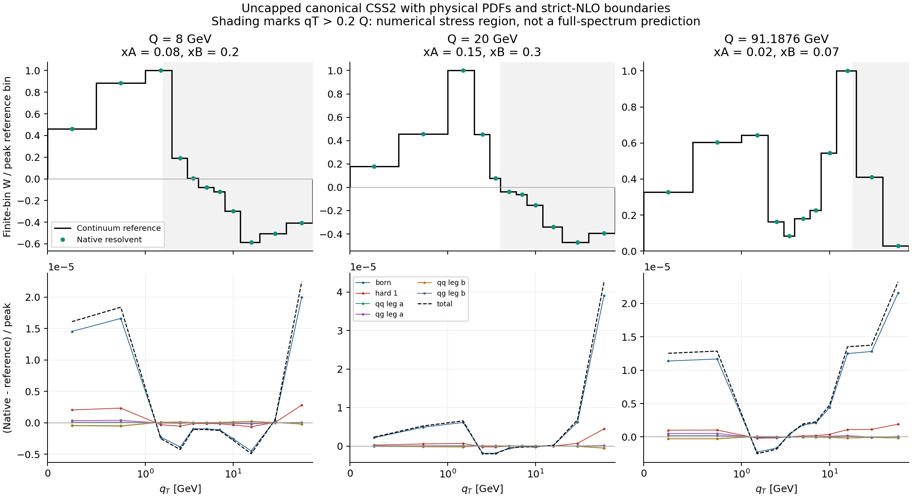

# k-space

## Transverse-momentum TMD evolution, computation, and verification

**A CSS2-based framework for keeping the perturbative operator and the fitted
transverse structure in momentum space.**

[Physics goals](#physics-goals) · [Quick start](#quick-start) ·
[Run an example](#two-runnable-examples) · [Choose a verification suite](#verification-map) ·
[Technical formalism](docs/FORMALISM.md) · [API](docs/API.md)

**Methods-paper validation:** [Results and limitations](docs/VALIDATION_RESULTS.md) ·
[Reproduce all checks](docs/REPRODUCE_METHOD_PAPER.md) ·
[Frozen numerical evidence](validation/README.md) ·
[Canonical derivation](docs/CANONICAL_DERIVATION.md)

`k-space` brings together distributional transverse-momentum calculus,
perturbative matching checks, unexpanded renormalization-group evolution, and a
momentum-space numerical evaluator. It is intended for phenomenologists developing
TMD extractions and for researchers checking the perturbative operator that an
extraction uses.

The scientific implementation, test inputs, and usage documentation are kept
together. The package includes both a lower-order demonstration and sourced,
fixed-flavor **N³LL evolution** coefficients. Hard and OPE boundaries remain
strict NLO, so the package does not claim an N³LL′ spectrum.

## Validated method and computational evidence

The 1 October 2026 audit combines the **same uncapped spectral-canonical
prescription** with physical PDFs, both legs and all six strict-NLO components.
A separately coded continuum reference checks bins, analytic input derivatives
and contacts at Q=8, 20 and 91.1876 GeV, including algebraic-tail inputs.

| Check | Audited result |
|---|---|
| Software tests | 121 passing at the audited source commit |
| Required scientific/component suites | 14/14 passing; overlapping evidence categories |
| Physical bin error, including the declared UV input bound | Below 4.27e-5 of the peak reference bin |
| Largest observed physical refinement budget | Below 3.47e-4, against the original 1e-3 limit |
| Provenance | Source/PDF hashes, accepted numerical records, separate components and refinement data |



The UV continuation of the finite PDF table is an explicit input condition.
The achieved bound over the declared UV input class is 1.67e-6 of the peak bin,
passing the 2e-6 numerical criterion. It remains included in the reported budget.
Two explicitly completed inputs and all other criteria pass. Signed
high-qT W-only bins are numerical stress tests. These results do not establish
N³LL′, complete W+Y, massive thresholds, global extraction, or independent human
scientific review. Read the [full interpretation](docs/VALIDATION_RESULTS.md).

The current publication is the methods paper. A same-data joint-(x,kT) FiLM
comparison with the bT extraction is a separate future project. The existing
E866 mixture fit is a conditional demonstration.

### Read the repository in three passes

| Your question | Start with |
|---|---|
| What is the physics goal, and what work has been implemented? | [Physics goals](#physics-goals) and [work represented here](#work-represented-here) |
| How do I use the code and interpret its output? | [Quick start](#quick-start), [examples](docs/EXAMPLES.md), and [API](docs/API.md) |
| Which statements are checked, with which inputs and limitations? | [Verification](docs/VERIFICATION.md), [coefficient inputs](docs/COEFFICIENTS.md), and [research scope](docs/RESEARCH_SCOPE.md) |

## Physics goals

TMD factorization separates short-distance scattering, collinear parton content,
transverse structure, and rapidity evolution. The conventional impact-parameter
representation makes transverse convolutions into products. This project retains
the CSS2 parent convention while organizing the working transverse objects as
momentum-space distributions and operators. The parent references and the
relationship to distribution-space resummation are collected in
[REFERENCES.md](docs/REFERENCES.md).

The program has four connected goals:

1. **Keep transverse structure in k<sub>T</sub> throughout the calculation.**
   Use distribution kernels, momentum-space convolutions, and elliptic solves so
   that the fitted input and evaluated output do not require numerical Fourier or
   Hankel transformations.
2. **Preserve perturbative control.** Link matching coefficients, Collins–Soper
   evolution, virtuality evolution, flavor ordering, and logarithmic counting to
   an explicitly declared CSS2 convention. The target high-accuracy prescription
   is N³LL′ with the stated physical inputs and domain assumptions.
3. **Separate the perturbative operator from the nonperturbative model.**
   A neural network, spline, analytic model, or other admitted input can describe
   unresolved transverse structure. The perturbative evolution and matching are
   supplied by the same operator framework rather than learned implicitly from data.
4. **Make every computational statement reproducible.** Associate each check with
   executable code, input coefficients or formal fixtures, tolerances, structured
   results, and source hashes. Keep numerical error, perturbative truncation, and
   statistical extraction uncertainties distinct.

The intended process workflow is:

```text
CSS2 conventions + perturbative inputs
                  │
      distribution / matching algebra
                  │
      unexpanded canonical RG operator
                  │
      momentum-space numerical evaluator
                  │
      admitted nonperturbative input
                  │
      process measurement and matched spectrum
                  │
      statistical extraction and closure tests
```

The code implements the operator and verification layers, same-prescription
physical benchmarks, and a separately qualified E866/neural demonstrator. A full
phenomenological extraction requires its own physical input and validation.
The scalar construction is not specialized to
fixed-target kinematics; extensions to other tensor structures, thresholds, and
measurements carry explicit additional conditions.

## Quick start

Use **Python 3.13** for the documented environment. The package declares
Python ≥3.11; the method audit was exercised with Python 3.13.15 and the pinned
dependencies in `requirements.txt`. CI uses Python 3.13.

From a clone of this repository:

```bash
python3 -m venv .venv
source .venv/bin/activate
python -m pip install -r requirements-dev.txt

python tools/check_repository_policy.py --check-prepared-hashes
python tools/check_validation_snapshot.py
python -m pytest -q
python run_all_checks.py --clean
```

After dependencies are installed, these checks run offline. The scientific
verification requires no external coefficient download or experimental data fit.
On Windows, activate the environment with `.venv\Scripts\Activate.ps1` and use
`python` for the same subsequent commands.

The complete scientific/component run should end with:

```text
all_suites_passed: True
suites: 14/14
```

The full reports are generated at:

```text
outputs/latest/run_all_checks_report.txt
outputs/latest/run_all_checks_summary.json
```

The 14-suite count includes different kinds of checks; it is not a sum of
independent physics results. Detailed counts and residuals are obtained from the
fresh per-suite reports. A selected-suite run records `full_required_run: false`.

### Choose a smaller run

```bash
# List the actual registered suites and their descriptions.
python run_all_checks.py --list

# Contact-preserving distributions, canonical boundary shifts, matrix ordering.
python run_all_checks.py --suite structural --output-dir outputs/structural

# Unexpanded RG, logarithmic-degree fixtures, and the lower-order grid example.
python run_all_checks.py --suite unexpanded --output-dir outputs/unexpanded

# Physical nf=5 N³LL evolution in the canonical operator.
python run_all_checks.py --suite physical_canonical --output-dir outputs/physical_canonical

# Original fixed-order transverse / longitudinal / convolution checks.
python run_all_checks.py --suite one_loop --suite toy_x --suite generator \
  --output-dir outputs/fixed_order
```

Each executed suite receives a fresh subdirectory. Use different output directories
to retain several runs. `--clean` removes only the explicitly selected child of
this repository's `outputs/` tree.

## Two runnable examples

These examples are entry points into the existing scientific implementation.
They call `src/resummed_operator.py`; they do not reimplement its equations.
Full parameter and output descriptions are in [EXAMPLES.md](docs/EXAMPLES.md).

### 1. Inspect the canonical evolution symbol

```bash
python examples/canonical_evolution.py --mu 20 --zeta 400 \
  --s 0 0.01 0.1 1

# Exercise the sourced physical N³LL evolution input; boundaries stay strict NLO.
python examples/canonical_evolution.py \
  --coefficients data/coefficients_css2_nf5_n3ll.json --mu 20 --zeta 400
```

This evaluates the dimensionless canonical leg at a final virtuality scale of
20 GeV and rapidity scale of 400 GeV². The argument `s` is a **spectral resolution
in GeV⁻²**, not a momentum bin. The input parameter `a0=0.02` means
α<sub>s</sub>(μ₀)/(4π), with μ₀=2 GeV.

Representative output from the supplied implementation is:

```text
s [GeV^-2]    v(s; mu, zeta)
          0    0
       0.01    1.03654351917
        0.1    0.955081651526
          1    0.819589040914
```

`outputs/examples/canonical/canonical_evolution.csv` contains the sampled values,
canonical scale, and CS symbol; the accompanying JSON records inputs and code
hashes. At `s=0`, the canonical leg uses its analytic zero endpoint and the
singular canonical scale/CS value are left unassigned. The scalar multiplier is
an evolution ingredient, not a probability density or a fitted TMD.

### 2. Apply evolution to a momentum-grid input

```bash
python examples/momentum_grid.py --reference
```

The default example uses a Gaussian input on a **17 × 17 interior grid**, with
Dirichlet boundary conditions and a box half-width of 8 GeV. The input is normalized
in the discrete L² norm. The application path uses sparse momentum-space elliptic
solves at Bernstein degrees 8, 32, and 128.

`--reference` adds an independent diagonalization of the **same finite matrix**
for checking the result. Without that flag, only the momentum-space recurrence
is evaluated.

| Degree | Observed same-grid L² error | Finite-matrix error bound |
|---:|---:|---:|
| 8 | 6.84344 × 10⁻² | 1.59389 × 10⁻¹ |
| 32 | 2.65618 × 10⁻³ | 1.25680 × 10⁻² |
| 128 | 2.76319 × 10⁻⁴ | 6.10150 × 10⁻³ |

These are rounded demonstration results, not portable bitwise targets. Acceptance
uses the criteria in the executable checks. The comparison controls the polynomial
approximation on this grid; varying box size and spacing is a separate continuum
study. These errors are not experimental or perturbative uncertainties.

Generated files:

```text
outputs/examples/grid/degree_convergence.csv
outputs/examples/grid/momentum_grid.csv
outputs/examples/grid/momentum_grid.json
```

The array CSV contains k<sub>x</sub>, k<sub>y</sub>, the input, and the evolved
array at the largest requested degree. The JSON records scales, grid, boundary
conditions, input hashes, and the reference method.

## Work represented here

### Distribution calculus and perturbative boundaries

The scalar fixed-order basis includes two-dimensional plus distributions,
contact terms, and a generator basis whose Fourier images are powers of the
impact-parameter logarithm. The finite-order dictionary is

```math
L_b^0\longmapsto\delta^{(2)}(\boldsymbol k),\qquad
L_b^m\longmapsto\mathfrak L_{m-1}(\boldsymbol k;\mu),\quad m\ge1.
```

Transverse convolution becomes a closed polynomial operation at fixed order.
The implementation checks the dictionary, its contact constants, and conventional
plus-basis conversions rather than treating singular distributions as ordinary
functions at the origin.

The profile-scale construction preserves the origin contact through the weak
cumulative action

```math
\langle\mathcal S_p A,\varphi\rangle
=-\int_0^\infty C_p(t)\,\psi_\varphi'(t)\,dt,
\qquad t=k_T^2.
```

A first bin therefore contains the full cumulative at its upper edge, including
any delta contribution. The structural checks also cover canonical momentum-boundary
translations through third order and ordered flavor-matrix logarithmic recurrences.

**Boundary conventions matter:** the momentum-disk boundary includes finite contact
shifts. The spectral-canonical construction below uses the parent boundary at
L<sub>b</sub>=0. Adding the disk shifts to that parent boundary again would double
count them. See [FORMALISM.md, boundary conventions](docs/FORMALISM.md).

### Unexpanded RG evolution

The CS symbol is reconstructed by integrating the retained RG system before
exponentiation:

```math
D_i^c(s;\mu)
=d_{i,[3]}\!\left(a(\mu_c(s))\right)
+2\int_{\mu_c(s)}^\mu\frac{d\nu}{\nu}
\Gamma_{i,[4]}\!\left(a(\nu)\right).
```

The bracketed orders describe the high-accuracy construction. The shipped numerical
example uses the explicitly smaller coefficient set described below. Its ODE solver
integrates the coefficients actually supplied; an array length or metadata flag
alone does not establish a physical accuracy label.

The completion scale is canonical at small spectral resolution and freezes to μ₀
in the infrared. It is independent of the hadron, x, and evolution endpoint, with
no ultraviolet cap. The endpoint kernel satisfies the retained-system CS and
virtuality equations, identity, inverse, and composition relations. The complete
canonical leg supplies the bounded symbol used by the numerical evaluator.

### Momentum-space operator evaluation

Define the nonnegative momentum-space Laplacian and its resolvent:

```math
T=-\nabla_k^2,\qquad R_\tau=\tau(\tau+T)^{-1}.
```

A completed canonical symbol is applied through contact-preserving approximants

```math
\mathbb M_N=M_\infty I+R_\tau B_N[h](R_\tau).
```

The source implements operator-valued de Casteljau recurrence and sparse solves
with `tau*I + T`. The constant contact coefficient is retained exactly at each
degree. Scalar spectral nodes determine polynomial coefficients; the input and
output arrays stay in momentum space. Independent diagonalization appears only
in validation references, not in the application recurrence.

The analytic convergence argument requires its stated symbol and input domains.
The package distinguishes those assumptions, numerical checks of examples, and
finite-grid error estimates in [FORMALISM.md](docs/FORMALISM.md) and
[RESEARCH_SCOPE.md](docs/RESEARCH_SCOPE.md).

The publication-oriented non-Gaussian transform comparison is documented in
[CANONICAL_CONTINUUM_BENCHMARK.md](docs/CANONICAL_CONTINUUM_BENCHMARK.md).

## Verification map

Every ID below is registered in
[`manifests/verification_suite.json`](manifests/verification_suite.json).
Use `python run_all_checks.py --suite ID` to run one; the script links identify
the actual calculations.

| Suite ID | Script | Main check and interpretation |
|---|---|---|
| `one_loop` | [One-loop bins](validators/kt_kcss_one_loop_validator.py) | Transverse plus-distribution bins and diagonal DY normalization |
| `toy_x` | [Toy longitudinal convolution](validators/kt_kcss_toypdf_xconv_validator.py) | Longitudinal plus prescription and flavor-vector toy-PDF assembly |
| `generator` | [Generator algebra](validators/kt_kcss_generator_convolution_validator.py) | Transverse convolution tables and generator identities |
| `fixed_evolution` | [Fixed-coupling evolution](validators/kt_kcss_one_loop_evolution_validator.py) | One-loop endpoint and semigroup checks |
| `two_loop` | [Two-loop ingredients](validators/kt_kcss_two_loop_ingredients_validator.py) | CS projection and scalar matching-log reconstruction |
| `running_expansion` | [Running-coupling expansion](validators/kt_kcss_running_coupling_evolution_validator.py) | Fixed-order RG-integral identities |
| `w_expansion` | [W-term prototype](validators/kt_kcss_binned_wterm_prototype_validator.py) | Binned fixed-auxiliary-scale singular expansion |
| `counting` | [Order manifest](validators/kt_kcss_accuracy_ingredient_validator.py) | Loop-order bookkeeping, not physical coefficient values |
| `mock_import` | [Matching import contract](validators/kt_kcss_n3lo_matching_import_validator.py) | Synthetic coefficient schema and projection checks |
| `structural` | [Structural verification](validators/validate_v1p4.py) | 102 contact, boundary, ordered-matrix, weak/bin, and counterexample checks |
| `resolvent_demo` | [Analytic multiplier demo](validators/resolvent_operator_demo.py) | 8 checks for a bounded test multiplier on a finite grid |
| `unexpanded` | [Unexpanded construction](validators/validate_unexpanded.py) | 95 symbolic, formal-fixture, lower-order QCD, and same-grid checks |
| `physical_canonical` | [Physical canonical evolution](validators/validate_physical_canonical.py) | Sourced 4/4/3/3-loop evolution, RG identities, and non-Gaussian same-grid action |
| `canonical_derivation` | [Canonical derivation audit](validators/audit_canonical_derivation.py) | Exact logarithmic-degree and matching identities with deliberate failure controls |

Some original component reports expose aggregate metrics rather than an individual
record list. The runner preserves that distinction instead of inventing a record
count. Overlapping tests and bookkeeping checks are not summed into a grand
perturbative certificate. [VERIFICATION.md](docs/VERIFICATION.md) gives the complete
scope and output map.

## Perturbative accuracy and supplied inputs

The analytic target is the CSS2-equivalent N³LL′ prescription under its stated
scalar, fixed-flavor, asymptotically free, infrared-completed assumptions.
The documentation separates the all-order logarithmic argument from finite
coefficient-degree regression tests.

| Ingredient | N³LL evolution convention | Included physical evolution input |
|---|---|---|
| QCD beta function | Four-loop running | β₀ through β₃ |
| Cusp anomalous dimension | Four loops | Γ₀ through Γ₃ |
| TMD noncusp anomalous dimension | Three loops | γ₀ through γ₂ |
| Canonical CS boundary | Through third order | d₁ through d₃, with d₁=0 |
| Hard and finite TMD matching functions | Strict NLO in current physical assembly | NLO hard and OPE insertions |
| Collinear evolution | P⁽⁰⁾, P⁽¹⁾, P⁽²⁾ | Toy and formal-matrix checks in the verification suites |
| Process spectrum | Matched measurement-level prediction | Singular-expansion prototype and operator examples |

[`data/coefficients_demo.json`](data/coefficients_demo.json) specifies the numerical
massless quark example with n<sub>f</sub>=5, μ₀=2 GeV, and a(μ₀)=0.02.
[`data/coefficients_css2_nf5_n3ll.json`](data/coefficients_css2_nf5_n3ll.json)
supplies the sourced physical N³LL evolution vector used by `physical_canonical`.
Their coefficient provenance and normalization are documented in
[COEFFICIENTS.md](docs/COEFFICIENTS.md). The formal rational fixtures used for
logarithmic counting and flavor ordering are identified separately at their use sites.

A passing run establishes the listed calculations with their recorded inputs.
Physical three-loop coefficient validation, a full process-specific W+Y spectrum,
heavy-flavor thresholds, continuum-grid control, and a statistical data extraction
remain distinct milestones. This distinction is part of the output schema, not an
inference from a test total.

## Nonperturbative inputs and experimental tables

The perturbative operator accepts admitted momentum-space inputs without choosing
a neural architecture. The current Gaussian example demonstrates that interface
and is normalized in L² for its numerical comparison; it is not an extracted
collinear-normalized TMD. Additional nonperturbative CS factors and longitudinal
matching/PDF multipliers must satisfy the product, universality, and growth
conditions stated in [FORMALISM.md](docs/FORMALISM.md).

The supplied [`Data_DY_test/`](Data_DY_test/) directory retains 21 CSV tables from
the source snapshot, including fixed-target and collider-named datasets. They are
**not consumed by the verification runner or examples**. Their row counts,
column names, hashes, and current provenance limits are described in
[DATA.md](docs/DATA.md). Experimental units, normalizations, cuts, correlated
uncertainties, and source attribution must be established before a fit uses them.
The presence of these files does not indicate a completed data analysis.

## Reproducibility and repository layout

```text
README.md                       Physics overview and runnable entry points
src/resummed_operator.py         Unexpanded RG symbols and sparse evaluator
examples/                       Canonical-symbol and momentum-grid examples
validators/                     Scientific/component verification suites
tests/                          Runner, policy, and example software tests
manifests/                      Suite registry, source lineage, input inventories
data/coefficients_demo.json      Declared lower-order coefficient input
data/coefficients_css2_nf5_n3ll.json
                                Physical nf=5 N³LL evolution; strict NLO boundaries
Data_DY_test/                   Preserved CSV tables (not used by verification)
docs/                           Formalism, API, examples, evidence, and scope
scripts/stage_public_coefficients.sh
                                Optional external-source acquisition helper
tools/                          Runner adapter and repository-policy checks
.github/workflows/               CI verification and downloadable run artifacts
outputs/                        Local generated results; excluded from Git
```

The runner creates new per-suite directories, captures process logs, and checks a
new structured report whose digest is bound to its suite and run ID. A successful
exit code or a stale report alone is not accepted. It records dependencies, script
and input hashes, thread settings, and Git state when available.

```bash
# Verify the unchanged imported scientific files against their source ledger.
python tools/check_repository_policy.py --check-prepared-hashes

# Equivalent maintenance entry points.
make policy
make test
make check
```

[REPRODUCIBILITY.md](docs/REPRODUCIBILITY.md) explains generated outputs, clean-run
behavior, provenance, and CI. Public files consist of science, tests, fixtures,
and human documentation. Local environments, Git working copies, prompts, agent
state, manuscript files, and build products are excluded from the distributed tree.

Optional acquisition of published high-order ancillaries is documented in
[`coefficient_sources/README.md`](coefficient_sources/README.md). It is separate
from verification, requires network access, and writes outside the repository.
Acquisition and hashes establish provenance; parsing and physical comparison
establish whether those coefficients can support a prediction.

## Citation, development, and license

Use [`CITATION.cff`](CITATION.cff) and record the **exact commit and input hashes**
used for a scientific run. The [reference guide](docs/REFERENCES.md) identifies the
parent factorization, distribution-space, rapidity-evolution, and matching sources.
A versioned archive DOI can be added when an actual release is archived.

Contributions should preserve sign conventions, contact terms, flavor ordering,
and boundary definitions. Changes to formulas, physical coefficients, tolerances,
or claimed scope should include an explicit justification and corresponding tests.
The source ledger records prior scientific imports; a deliberate scientific change
should record its new hash rather than retain a byte-identity claim.

The software license is [MIT](LICENSE). Third-party data and downloaded coefficient
sources retain their own licensing and attribution requirements.

## Corrected CSS2 diagnostic branch

The [resolution prescription](docs/CSS2_RESOLUTION.md) adds sourced N3LL
evolution, corrected general-scale NLO matching, strict insertion assembly,
and an independently checked physical-PDF point. Its scope is a fixed
proton--proton diagnostic; experimental reference reproduction remains separate.

The [noncanonical prescription](docs/NONCANONICAL_PRESCRIPTION.md) adds
three-loop CS-boundary transport, fixed-flavor domain guards and an E605
primary-point measurement adapter. Threshold-crossing production remains gated.

The [E866 proton-only baseline](docs/E866_PP_BASELINE.md) adds explicit mass/xF
and transverse-bin integration, a high-scale massless matching prescription,
and a shared Gaussian boundary with a nonperturbative CS term. Its documented
measurement and identifiability limits remain part of the calculation's scope.

The [native-kT DNN pilot](docs/NATIVE_DNN_PILOT.md) learns x-dependent mixture
boundaries through the native elliptic operator, with explicit measured-bin
weights, analytic neural gradients and independent non-Gaussian closure.
