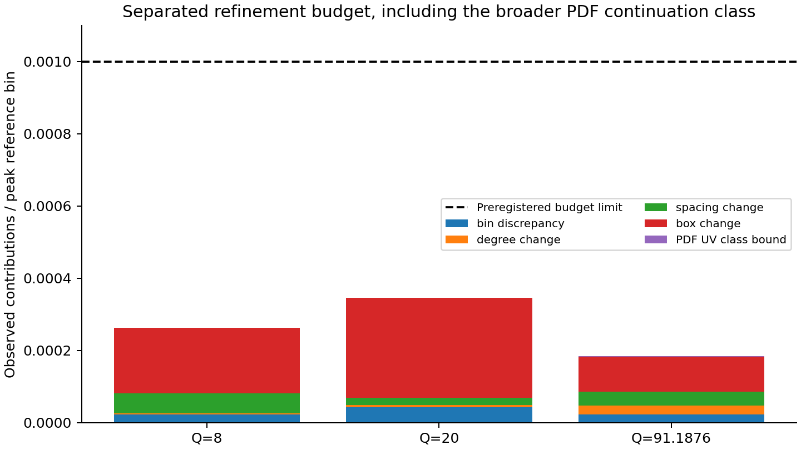

# Computational validation and numerical results

The audited result is **N3LL evolution with strict-NLO hard and OPE boundaries**
in the uncapped, endpoint-independent spectral-canonical CSS2 prescription. The
implementation keeps the input and production action in transverse momentum.
Fourier/Bessel calculations are used as separately implemented references.

The accepted numerical snapshot, individual checks and refinement data are in
[validation/](../validation/README.md). [Reproduction instructions](REPRODUCE_METHOD_PAPER.md)
separate the offline suite, full physical benchmark and conditional fit examples.
The analytic reasoning is in [the derivation](CANONICAL_DERIVATION.md); exact
scope is in [the method claim](METHOD_PAPER_SCOPE.md).

## Evidence layers

| Layer | What is checked | Result and limit |
|---|---|---|
| Software contracts | Input domains, finite grids, exact endpoints, spectral/Clenshaw comparisons, native convolution and analytic derivatives | 121 tests pass at the audited commit; software tests are not independent physics results |
| Distributional algebra | Plus cumulants, convolution generators, origin contacts, shifts and ordered flavor structures | Required suites pass; higher-order synthetic fixtures remain synthetic |
| CSS2 RG and counting | Two-scale identities, independent quadrature, physical 4/4/3/3-loop vector, exact finite-order witnesses and omitted-loop controls | 14/14 registered suites pass; includes 25 physical canonical and 16 derivation checks |
| Physical inputs | Primary source normalization and scheme conversion, independent cusp expressions, pinned actual PDF data | nf=3,4,5,6 cusp disagreement below 2.4e-11 absolute; no numerical N3LL-prime boundary claim |
| Continuum action | Non-Gaussian input, finite bins, analytic derivatives, degree/spacing/radius studies | Independent continuum comparisons pass; distinct from same-matrix eigendecomposition tests |
| Same-prescription physical assembly | Actual PDFs, charge sums, both beam orientations, six linear NLO components, two legs, gradients and contacts | Three-scale physical comparisons pass the original primary limits under the explicit UV input condition |
| Inverse demonstration | Restricted neural mixture, independent closure, withheld bins and conditional E866 fit | Workflow demonstrated; no general functional identification or calibrated uncertainty claim |

See [the verification map](VERIFICATION.md) for every suite ID and executable.
Counts overlap in subject matter and must not be summed into a physics pass total.

## Identical-prescription physical benchmark

Both paths use the uncapped canonical prescription, not the capped E866 process
profile. The coefficient inputs are four-loop beta/cusp and three-loop
noncusp/CS. Matching is canonical at b_eval=b0/mu_c. Physical longitudinal inputs
are NNPDF40_nnlo_as_01180 member 0; running is independently fixed at massless nf5
with alpha_s(91.1876 GeV)=0.1180024. The hard/OPE assembly contains Born, hard,
qq on each leg, and qg on each leg, without incomplete higher-order products.

The three configurations are (Q,xA,xB)=(8,.08,.20), (20,.15,.30), and
(91.1876,.02,.07), with Q in GeV. Low and high scales use two Student legs with
powers 3 and 4 and x-dependent scales; the middle case uses a Gaussian pair.
The transverse family is shared across flavors for this benchmark.

The reference shares physical coefficient numbers and the official PDF provider.
It independently implements endpoint RG integration, longitudinal matching in
log(xi), the charge/antiparticle sum, and adaptive continuum Bessel bins using
analytic input transforms. It does not import production RG, matching or
physical-symbol routines. A separate adaptive integration checks its cache.

| Q [GeV] | Bin error | Largest component error | Log-scale gradient error | Contact error | Observed budget |
|---|---|---|---|---|---|
| 8 | 2.25e-5 | 2.00e-5 | 2.56e-5 | 2.39e-5 | 2.63e-4 |
| 20 | 4.27e-5 | 3.91e-5 | 6.12e-6 | 4.08e-5 | 3.47e-4 |
| 91.1876 | 2.50e-5 | 2.31e-5 | 2.64e-5 | 2.14e-5 | 1.85e-4 |
| Original limits | 5e-4 | 5e-4 | 1e-3 | 5e-4 | 1e-3 |

Entries are rounded upward and normalized to each case's peak reference total.
They include the broader PDF continuation-class bound. This is not a uniform
relative error guarantee for every small or cancellation-sensitive bin; the
reports retain per-bin relative errors and signed values. The derivative is
with respect to log(lambda_A), not a derivative of the longitudinal PDF.

The observed budget adds the final discrepancy, last degree/spacing/radius
changes, continuum quadrature and the UV class bound. It is not a rigorous global
operator-norm certificate or an estimate of perturbative/experimental uncertainty.

The Q=8 and 20 cases use radius 1280 GeV, degree 2048 and spacing .0125 GeV.
The high-scale case uses radius 5120 GeV and degree 4096 at the same spacing.
Separate lower-degree, coarser-spacing and smaller-box runs are retained. Large
radii are numerical domains, not physical support or recommended fit settings.
Independent RG tolerance refinement changes log evolution by less than 1e-9;
production agrees with the tight reference to better than 4.8e-12 at sampled
points. Omitting a matching leg or inserting an extra pi is clearly detected.

## Finite PDF table and achieved ultraviolet bounds

The source table ends at 1e5 GeV. Production never silently extrapolates PDFs or
caps the canonical scale. The admitted broader class obeys
|f(x,mu)| <= |f(x,1e5)|[1+ln(mu/1e5)]^4 above that scale, including convolution
arguments. Absolute matching integrals and monotone RG decay give conditional
bin/component bounds. Their evaluation is numerical, not interval arithmetic.

The largest achieved class bound is 1.6683e-6 of the peak. Two explicitly
completed benchmark inputs, constant endpoint PDFs or fourth-power logarithmic
growth, resolve their omitted integrals with residual estimates below 1e-17 of
the peak. Their largest difference is 1.532e-6. Neither is claimed to solve DGLAP
outside the table. The broader class bound stays in the original primary errors
and budget, all of which pass. A universal 1e-6 bound over the unspecified
continuation class is not claimed.

The accepted implementation assigns the exact infrared constant at s=infinity
and uses the separately refined numerical domains listed above. The release
contains the accepted results; development attempts remain in the local audit
archive. The completion auditor verifies source identity and rejects unresolved
primary failures rather than relaxing their tolerances.

## Other numerical and inverse checks

The ordinary-input canonical continuum benchmark reaches bin discrepancy
4.51e-5, analytic-gradient discrepancy 1.13e-4, and observed bin budget 2.28e-4
against its 4e-4 budget limit. The accepted evaluator uses the endpoint-preserving
Chebyshev route. See the
[continuum study](CANONICAL_CONTINUUM_BENCHMARK.md).

The [E866 forward calculation](E866_PP_BASELINE.md) and
[neural pilot](NATIVE_DNN_PILOT.md) use a separately qualified capped profile.
For the restricted mixture closure, the best training-bin error is 7.58e-5 and
withheld-bin error 6.66e-4. The conditional 41-bin data fit has total chi2=21.678
including a normalization nuisance. It uses diagonal point uncertainties and a
restricted shared-flavor input; no effective degrees of freedom, coverage,
general profile recovery, or extraction advantage is inferred from that number.

## What these results do not establish

The physical benchmark is a massless fixed-nf5 photon W term, including a formal
five-flavor UV continuation. It does not include Z exchange, massive thresholds,
complete W+Y matching or a global extraction. Signed high-qT bins are operator
stress tests. The canonical zero spectral endpoint obstructs an everywhere-positive
integrable output with nonzero total normalization; the W term is not a complete
inclusive cross section. The capped demonstrator does not inherit the uncapped
theorem. This development audit used separately coded references but is not
independent human scientific review.
